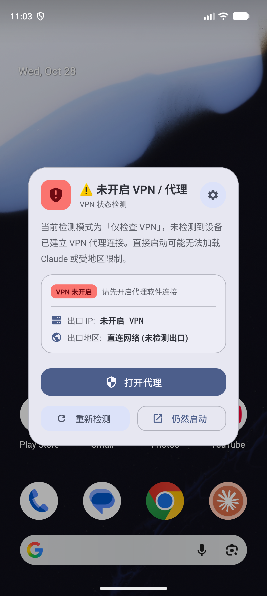
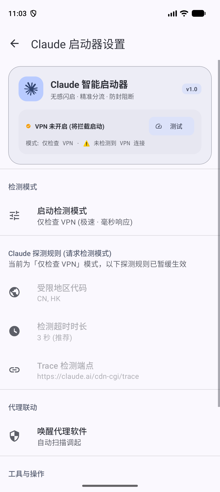

# Claude 启动器 (Claude Launcher for Android)

[](https://github.com/FlintyLemming/claude-launcher-android/releases/latest)
[](https://github.com/FlintyLemming/claude-launcher-android/releases/latest)

> 📥 **下载安装**：前往 [GitHub Releases](https://github.com/FlintyLemming/claude-launcher-android/releases/latest) 获取最新发布的安装包（`.apk`）。

> [!WARNING]
> **免责声明**：**本工具只是图一乐，并不能帮助你避免被 Claude 封号**。账号安全与风控机制取决于你的节点纯净度、代理质量及 Anthropic 官方策略，本启动器仅作为在启动应用前的网络/代理状态检查与拦截辅助工具，请理性使用。

一款专为 Android 设计的 Claude 启动防护与辅助工具。在进入 Claude 客户端之前，自动检测当前设备的 VPN 与网络环境，拦截直连或受限地区的直接启动，降低误连风险。

<p align="center">
  
  &emsp;&emsp;
  
</p>

---

## ✨ 主要功能

- ⚡ **双模式快速检测**：
  - **仅检查 VPN（极速推荐）**：毫秒级响应，直接基于系统底层虚拟接口与网络状态检测是否已连接 VPN，无网络往返耗时，秒级放行启动。
  - **请求 Claude 检测（精准分流）**：向 `https://claude.ai/cdn-cgi/trace` 发起轻量探测，准确检验当前出口 IP 与地区（支持自定义拦截 CN、HK 等地区）。
- 🛡️ **未连代理/受限地区弹窗拦截**：
  - 未开启代理或命中受限地区时弹出 Material 3 拦截窗口，提示当前网络状态；
  - 避免在直连无代理状态下误开 Claude 造成网络报错或触发风控。
- 🚀 **主流代理软件一键联动**：
  - 拦截时支持一键拉起已安装的代理客户端（Clash、Sing-box、Surfboard、v2rayNG、NekoBox、FlClash 等）；
  - 开启代理返回后可原位快速「重新检测」或继续启动；支持「仍然启动」应急放行。
- ⚙️ **简洁无感交互与 App Shortcuts**：
  - 桌面仅需保留一个 Claude 图标，点击直接进入检测并拉起官方 App；
  - **长按桌面图标**唤出系统级「设置」快捷入口，随时调整检测规则与偏好设置。

---

## 🛠️ 设置与配置项

在启动器设置中可按需配置：
1. **启动检测模式**：自由切换「仅检查 VPN」与「请求 Claude 检测」；
2. **受限地区代码**：仅在请求检测模式生效（默认拦截 `CN, HK`，支持自定义）；
3. **检测超时时长**：1 ~ 8 秒自由调节（推荐 3 秒）；
4. **唤醒代理软件**：自动扫描或指定优先调起的目标代理工具；
5. **即时网络测试**：在设置页内快速测试当前网络与节点是否联通。

---

## 📦 编译构建

本项目基于 Gradle 构建，需要 JDK 17+：

```bash
# 编译 Debug APK
./gradlew assembleDebug

# 运行单元测试
./gradlew testDebugUnitTest
```

编译生成文件位于：`app/build/outputs/apk/debug/app-debug.apk`

---

## 📄 开源许可

本项目遵循 MIT 开源许可协议。
